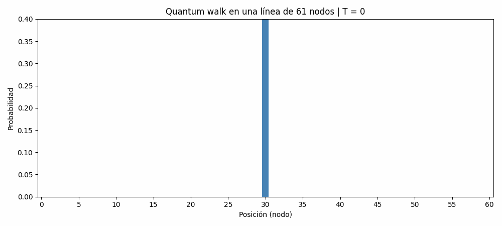

# Zitterwalk

A Python package for simulating quantum walks, created for the Collaboration Grant with the Department of Theoretical Physics at the University of Valencia.

*Quantum walk on a line of 61 positions over 100 time steps.*
