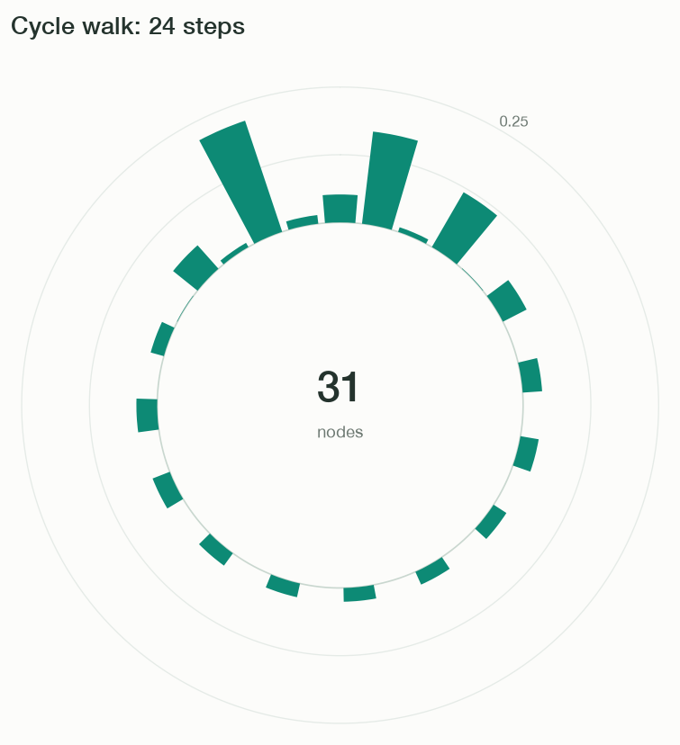

# Quantum Walk on a Circle

A cycle connects the last node back to the first, so every node has degree two. This example starts at node 15 and uses a single Hadamard coin for all nodes. The circular plotting mode displays each probability as a bar rising from a common circle.

Run this code from the repository root after [installing the dependencies](../getting-started.md#1-install-and-run). It saves `circle.png` in the current directory and opens the figure.

```python
import matplotlib.pyplot as plt
import numpy as np

from coin import Coin
from graph import Graph
from plotter import Plotter
from walker import Walker

graph = Graph.cycle(31)
walker = Walker(graph, Coin.hadamard())
walker.localize(15, np.array([1, 1j]) / np.sqrt(2))
walker.steps(24)

plotter = Plotter(graph, mode="circular", ymax=0.25, title="Cycle walk: 24 steps")
plotter.update(walker.probabilities())
for label in plotter.ax.texts:
    if label.get_text() == "nodos":
        label.set_text("nodes")
plotter.fig.savefig("circle.png", dpi=120, bbox_inches="tight")
plt.show()
```



Unlike a finite line, the cycle has no reflecting endpoints: amplitude can pass directly between nodes 30 and 0 and interfere after traveling around the cycle. Node 0 is at the top, with subsequent nodes arranged clockwise; bar height above the common circle represents probability.

See [Graph.cycle](../api/graph.md#graph.Graph.cycle) and [Plotter](../api/plotter.md).
