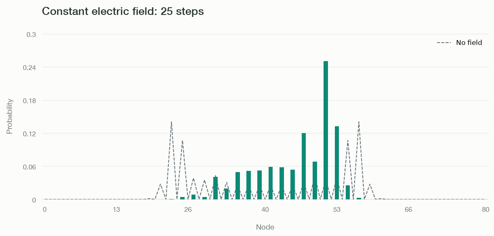

# Quantum Walk with an Electric Field

A static potential changes the relative phases accumulated during a walk. Here a constant physical electric field is represented by a linear potential on a line with unit node spacing. The dashed curve shows a walk with the same initial state and no field, making the change in the probability distribution visible.

The existing `potential_from_field()` helper computes $V_n = F_n \cdot (r_n-r_{\mathrm{ref}})$ with a **positive** dot product. To use the electrostatic convention $E=-\nabla V$, pass `-electric_field` to `uniform_field()`, giving $V_n=-E(x_n-x_{\mathrm{ref}})$. The walker applies $\exp(-i q V_n\,\Delta t)$ after the coin and shift, with $\hbar=1$.

Run this code from the repository root after [installing the dependencies](../getting-started.md#install-and-run). It saves `electric-field.png` in the current directory and opens the figure.

```python
import matplotlib.pyplot as plt
import numpy as np

from coin import Coin
from fields import potential_from_field, uniform_field
from graph import Graph
from plotter import Plotter
from walker import Walker

graph = Graph.line(81)
graph.set_coords({node: node - 40 for node in graph.nodes})
coins = {
    node: Coin.hadamard() if graph.degree(node) == 2 else Coin.identity(1)
    for node in graph.nodes
}
electric_field = 0.12
field = uniform_field(graph, -electric_field)
potential = potential_from_field(graph, field, reference=40)
walker = Walker(graph, coins, potential=potential, q=1.0, dt=1.0)
free = Walker(graph, coins)
for walk in (walker, free):
    walk.localize(40, np.array([1, 1j]) / np.sqrt(2))
    walk.steps(25)

plotter = Plotter(graph, mode="bars", ymax=0.3, title="Constant electric field: 25 steps")
plotter.update(walker.probabilities())
plotter.ax.plot(np.arange(graph.num_nodes), free.probabilities(),
                color="#61717d", linestyle="--", linewidth=1.2, label="No field")
plotter.ax.set(xlabel="Node", ylabel="Probability")
plotter.ax.legend(frameon=False)
plotter.fig.savefig("electric-field.png", dpi=120, bbox_inches="tight")
plt.show()
```



The field changes interference over repeated steps while preserving the total probability. A phase alone does not change node probabilities at the instant it is applied; its effect becomes visible in later evolution. Setting `electric_field = 0.0` reproduces the free walk. Both walks stay far from the endpoints during these 25 steps.

See [Fields](../api/fields.md) for the helper's precise convention and [Walker](../api/walker.md) for potential arguments.
