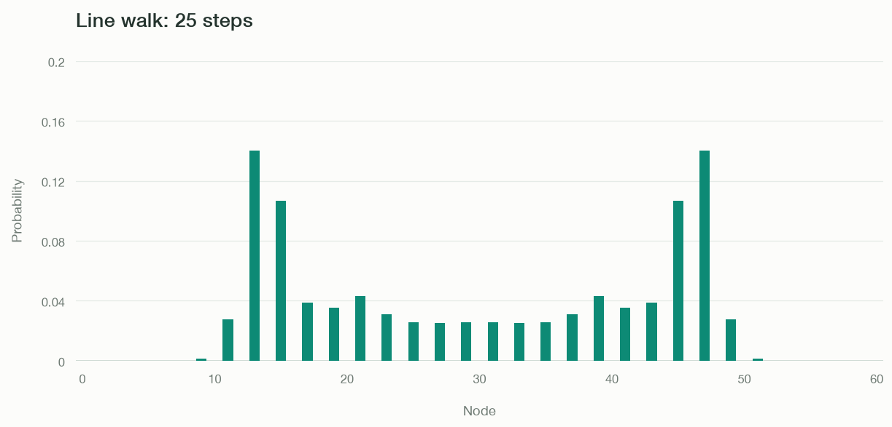

# Quantum Walk on a Line

A finite line has two endpoints (of degree one) and degree two interior nodes. This example initializes the walker at the center with equal-magnitude amplitudes and a relative phase of $i$, then evolves it for 25 steps. The endpoints are far enough away that the walk has not yet reached them (this makes everything easier to visualize).

Run this code from the repository root after [installing the dependencies](../getting-started.md#install-and-run). It saves `line.png` in the current directory and opens the figure.

```python
import matplotlib.pyplot as plt
import numpy as np

from coin import Coin
from graph import Graph
from plotter import Plotter
from walker import Walker

graph = Graph.line(61) # Create graph
coins = {
    node: Coin.hadamard() if graph.degree(node) == 2 else Coin.identity(1)
    for node in graph.nodes
} # Create Hadamard coin

walker = Walker(graph, coins)
walker.localize(30, np.array([1, 1j]) / np.sqrt(2))
walker.steps(25)

plotter = Plotter(graph, mode="bars", ymax=0.2, title="Line walk: 25 steps")
plotter.update(walker.probabilities())

plotter.ax.set(xlabel="Node", ylabel="Probability")
plotter.fig.savefig("line.png", dpi=120, bbox_inches="tight")
plt.show()
```



The distribution spreads through interference between arc amplitudes. Probability alternates between even and odd node indices at successive steps. With more steps (than nodes), the one dimensional identity coins at the endpoints reflect the walk back into the line.

See [Graph.line](../api/graph.md#graph.Graph.line), [Coin](../api/coin.md) and [Walker](../api/walker.md).
